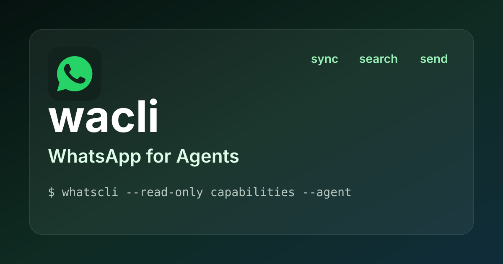

# WhatsCLI — WhatsApp for Agents



[](https://github.com/gabrielMalonso/whatscli/actions/workflows/ci.yml)
[](LICENSE)
[](docs/index.md)

WhatsCLI is a scriptable WhatsApp client for terminals, scripts, and coding agents, developed and maintained by [Gabriel Monteiro Alonso](https://github.com/gabrielMalonso). It builds on [WACLI](https://github.com/openclaw/wacli) with agent capability discovery, explicit account selection, immutable drafts, retained outbound attempts, and resumable local change streams. It pairs as a linked device, mirrors messages into a local SQLite store, and supports search, sending, and chat management.

> `whatscli` uses the WhatsApp Web protocol through [`whatsmeow`](https://github.com/tulir/whatsmeow). It is not affiliated with WhatsApp or Meta.

## Install

Build this fork with Go 1.27.0 or newer, a C compiler, Node.js 24 or newer, and the pnpm version pinned in `package.json`:

```sh
git clone https://github.com/gabrielMalonso/whatscli.git
cd whatscli
pnpm install --frozen-lockfile
pnpm build
./dist/whatscli --version
```

Add the checkout's `dist/` directory to your `PATH` to use `whatscli`. Local builds also produce `dist/wacli` for existing scripts.

WhatsCLI is hosted at `gabrielMalonso/whatscli`, with `whatscli` as its primary command. The upstream Homebrew formula and releases install WACLI, not this fork. WhatsCLI publication and signing are separate setup steps; see the [installation guide](docs/install.md) and [release notes](docs/release.md).

## Quick start

Pair the CLI by scanning the terminal QR code from WhatsApp's **Linked devices** screen. `auth` performs the first sync after pairing.

```sh
whatscli auth
whatscli messages search "meeting"
whatscli send text --to +15551234567 --message "hello"
```

Sending requires a recipient you are allowed to contact. Recipients can be phone numbers, WhatsApp JIDs, or synced contact, group, and chat names.

The [quickstart](docs/quickstart.md) covers phone-number pairing, named accounts, media, and diagnostics.

## Keep messages in sync

Run a continuous sync to keep the local store current:

```sh
whatscli sync --follow
```

`whatscli` keeps the WhatsApp session and its own searchable message index in separate SQLite databases. Search reads the local index, so it works without a live WhatsApp connection:

```sh
whatscli messages search "invoice" --has-media
whatscli --json messages list --limit 20
```

WhatsApp Web provides history on a best-effort basis. Use [`history coverage`](docs/history.md) to inspect what is available locally before requesting older messages from the primary phone.

## Use whatscli from scripts

Human-readable tables are the default. Use `--json` for one-shot commands and `--events` for NDJSON lifecycle events from long-running commands. Progress and errors stay on stderr.

Use `--read-only` or `WACLI_READONLY=1` to reject intentional WhatsApp mutations and archive writes by whatscli:

```sh
whatscli --read-only --json messages search "invoice"
WACLI_READONLY=1 whatscli --json doctor
```

This policy still permits requested [message export files](docs/messages.md#export), [media download output](docs/media.md#download), and [transcription through an explicitly selected adapter](docs/media.md#explicit-local-transcription). Downloads may use the network; the adapter is not sandboxed and can make its own network requests or file writes. Normal readonly SQLite may create or update WAL/SHM bookkeeping and fails when required bookkeeping is unavailable; see [store readonly access](docs/store.md#local-reads-by-default) for the no-create and snapshot limits.

Write commands take a per-store lock. After a `sync --follow` process finishes startup, supported send commands plus the `chats` state commands (`mark-read`, `archive`, `pin`, `mute`, and their inverses) are delegated to it while it owns that lock. See [companion integrations](docs/integrations.md) for webhooks and safe read-only SQLite access.

## Start an agent workflow

Start with [Agent daily use](docs/agent-daily-use.md) for the routine workflow: continuous sync, live owner status, cursor watching, inbox/context review, immutable drafts, sending, files/audio, anchored history recovery and handoff. For live work, complete its [startup checklist](docs/agent-daily-use.md#live-session-startup-checklist) first: verify the executable/account and keep one compatible sync owner plus a managed change consumer running. The [browser CLI coverage checklist](docs/browser-cli-coverage.md) records equivalents and limitations for a complete reference service-desk workflow. Use the full command references when the task needs more detail.

The following are offline archive queries; they do not start sync or the stream. Discover static capabilities without an account, then list accounts with legacy JSON and choose a name explicitly for bounded queries:

```sh
command -v whatscli || exit "$?"
whatscli --read-only capabilities --agent || exit "$?"
whatscli --read-only accounts list --json || exit "$?"
# Bind to the exact requested name reviewed in data.accounts; this name is illustrative.
wacli_account='example-account'
whatscli --account "$wacli_account" --read-only --agent auth status
whatscli --account "$wacli_account" --read-only --agent messages list --limit 20
```

Start with [account selection](docs/accounts.md) and the [agent contract](docs/agent.md) for supported commands, typed errors, compact/full recovery and pagination. Help/version remain text; `--json` and human tables remain available. Local results do not certify current connectivity, freshness or complete WhatsApp history. The read-only policy exceptions above still apply.

For an authorized write, read [drafts](docs/drafts.md) to prepare/review an exact revision, then [outbound](docs/outbound.md) for explicit dispatch and retained evidence. A preview/hash records no approval; an uncertain result calls for inspection, not automatic replay. Use [media](docs/media.md) only when that task needs file observation, download or recovery.

These checkout docs describe WhatsCLI's implementation; [verify the resolved executable and capabilities](docs/install.md#verify-the-executable-for-agent-work) before using the guide. A source build in `dist/` does not automatically update PATH or a running owner. [Fork maintenance](docs/fork-maintenance.md) defines the fork-only PR/push workflow and separate release authorization.

## Commands

| Area | What it covers |
| --- | --- |
| [`capabilities`](docs/agent.md#static-capability-discovery) | Discover static command support and agent contract limits without opening an account. |
| [`auth`](docs/auth.md), [`accounts`](docs/accounts.md) | Pair a linked device and manage isolated account stores. |
| [`sync`](docs/sync.md), [`history`](docs/history.md) | Mirror new events and request older per-chat history. |
| [`messages`](docs/messages.md), [`calls`](docs/calls.md) | Search, inspect, export, and manage local records. |
| [`send`](docs/send.md), [`media`](docs/media.md) | Send text and files or download synced media. |
| [`contacts`](docs/contacts.md), [`chats`](docs/chats.md) | Find people and manage local or remote chat state. |
| [`groups`](docs/groups.md), [`channels`](docs/channels.md) | Inspect and manage groups, communities, and channels. |
| [`profile`](docs/profile.md), [`presence`](docs/presence.md) | Manage profile details and chat presence. |
| [`store`](docs/store.md), [`doctor`](docs/doctor.md) | Inspect local storage and diagnose the setup. |

The complete documentation is in [docs/](docs/index.md), or run `whatscli help <command>` for the installed command reference.

## Compatibility

The primary command is now `whatscli`; `pnpm wacli` and `dist/wacli` remain local aliases. This rebrand keeps the existing `WACLI_*` environment variables, account configuration, store directories, `wacli.db`, `session.db`, JSON contracts, cursors, IPC hashes, transcription protocol, and webhook signature header unchanged. No data migration or new pairing is required by the name change; normal executable/owner upgrade checks still apply.

## Configuration

The default store is `~/.local/state/wacli` on Linux and `~/.wacli` elsewhere. Override it with `--store DIR` or `WACLI_STORE_DIR`; use named accounts when each WhatsApp identity needs its own session, database, and lock.

```sh
whatscli accounts add work
whatscli --account work sync --follow
```

See [accounts](docs/accounts.md) for store selection and [sync](docs/sync.md) for storage limits, media downloads, webhooks, and presence behavior.

## Development

Development uses the Go 1.27.1 toolchain selected by `go.mod`, Node.js 24 or newer, pnpm, cgo, and a C compiler. The source minimum remains Go 1.27.0.

```sh
pnpm install --frozen-lockfile
pnpm build
pnpm format:check && pnpm lint && pnpm test
```

## Credits

WhatsCLI is derived from [WACLI](https://github.com/openclaw/wacli), originally created by [Peter Steinberger (@steipete)](https://github.com/steipete) and maintained upstream by [@dinakars777](https://github.com/dinakars777), together with its contributors. The original Git history and MIT copyright notice are preserved.

WACLI was heavily inspired by [`whatsapp-cli`](https://github.com/vicentereig/whatsapp-cli) by Vicente Reig. WhatsCLI uses [`whatsmeow`](https://github.com/tulir/whatsmeow) by Tulir Asokan for the WhatsApp Web protocol.

## Maintainer

[Gabriel Monteiro Alonso (@gabrielMalonso)](https://github.com/gabrielMalonso) maintains WhatsCLI and its additions.

## License

[MIT](LICENSE).
